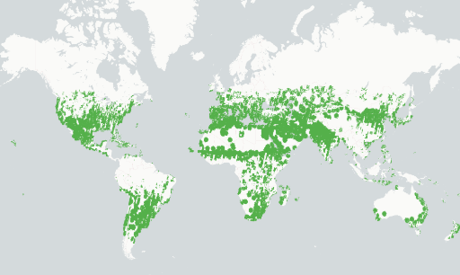

# GloSeaN: Global Seasonal NDVI Archive

## Overview

| Attribute | Value |
|-----------|-------|
| **Dataset Name** | GloSeaN (Global Seasonal NDVI Archive) |
| **Locations** | 200,000 released (250,000 sampled, filtered for completeness) |
| **Temporal Coverage** | 1990-2024 (35 years) |
| **Seasonal Resolution** | 4 observations per year (spring, summer, fall, winter) |
| **Total Temporal Bands** | 140 bands per location (35 years x 4 seasons) |
| **Spatial Tile Size** | 264 x 264 pixels |
| **Pixel Resolution** | 30 meters (Landsat native) |
| **Output Format** | GeoTIFF with embedded band descriptions |
| **Coordinate Reference System** | EPSG:4326 (WGS84) |

**Related Documentation:**
- [Dataset Splits](specific/dataset_splits.md) - train/val/OOD split design, manifest, sharding and training usage
- [Dataset Statistics](dataset_statistics.md) - split sizes, land cover, geographic distribution

---

## 1. Sampling Location Selection (SSL4EO-L)

GloSeaN's sampling locations are derived from the [SSL4EO-L](https://arxiv.org/abs/2306.09424) dataset (Stewart et al., 2023), a self-supervised learning benchmark for Landsat imagery.

### Summary

**250,000 globally distributed locations** were sampled (`data/locations.json`), each providing a 35-year seasonal time series. **200,000** remain after the completeness filter and form the released dataset (`data/locations_200k.json`). Locations are drawn from a Gaussian centred on one of the world's 10,000 most populous cities (σ = 50 km), which maximizes landscape diversity—capturing agriculture, urban areas, forests, grasslands, and water bodies that naturally cluster around human settlements. This city-centered approach ensures the dataset is relevant to key applications like food security monitoring, urban expansion tracking, and ecosystem management. The global distribution covers all inhabited continents while focusing on regions where long-term vegetation change has the greatest societal impact.


*Figure: Global distribution of the 250,000 SSL4EO-L sampling locations used in this dataset.*

### Original SSL4EO-L Dataset

The original SSL4EO-L dataset is a multi-sensor, multi-spectral benchmark containing **5 million patches** for self-supervised learning:

| Attribute | Value |
|-----------|-------|
| **Total patches** | 5M (250K × 4 seasons × 5 sensor/products) |
| **Locations** | 250,000 |
| **Seasons per location** | 4 |
| **Patch size** | 264 × 264 pixels (7.92 × 7.92 km) |
| **Resolution** | 30 meters |

**Seasonal Sampling:**

Images are selected from **60-day windows** centered on astronomical season boundaries:

| Season | Center Date | Window |
|--------|-------------|--------|
| Spring | March 21 (vernal equinox) | Feb 19 – Apr 20 |
| Summer | June 21 (summer solstice) | May 22 – Jul 21 |
| Fall | September 23 (autumnal equinox) | Aug 24 – Oct 23 |
| Winter | December 21 (winter solstice) | Nov 21 – Jan 20 |

All four seasonal images must be collected within a 2-year window and contain <20% cloud coverage.

**Sensors and Products (5 total):**

| Sensor | Product Level | Time Period | Bands |
|--------|---------------|-------------|-------|
| Landsat 5 TM | TOA (Level-1) | 2009-2010 | 7 bands |
| Landsat 7 ETM+ | TOA (Level-1) | 2001-2002 | 8 bands (incl. panchromatic) |
| Landsat 7 ETM+ | SR (Level-2) | 2001-2002 | 6 bands |
| Landsat 8/9 OLI/TIRS | TOA (Level-1) | 2021-2022 | 11 bands |
| Landsat 8/9 OLI | SR (Level-2) | 2021-2022 | 7 bands |

**Spectral Bands (OLI/TIRS example):**
- Coastal aerosol, Blue, Green, Red, NIR, SWIR-1, SWIR-2, Panchromatic, Cirrus, Thermal-1, Thermal-2

### GloSeaN vs. Original SSL4EO-L

| Aspect | Original SSL4EO-L | GloSeaN |
|--------|-------------------|------------------|
| **Spectral** | Full multispectral (7-11 bands) | Single band (NDVI) |
| **Temporal depth** | 1-2 years per sensor | 35 years continuous |
| **Time range** | 2001-2002, 2009-2010, 2021-2022 | 1990-2024 |
| **Samples per location** | 4 (one per season) | 140 (35 years × 4 seasons) |
| **Seasonal sampling** | 60-day windows | 90-day windows (±45 days around target DOY) |
| **Cloud handling** | <20% cloud cover filter | Scene filter (`CLOUD_COVER` < 70%) + QA_PIXEL pixel masking |
| **Focus** | Spatial diversity, multi-sensor | Temporal depth, change detection |

**Shared design:** Both datasets use **astronomical season boundaries** (equinoxes and solstices) as target dates—spring equinox (~March 20), summer solstice (~June 21), autumn equinox (~September 22), and winter solstice (~December 21). These dates are chosen to **maximize seasonal changes** in the imagery, capturing the most distinct phenological stages: vegetation green-up (spring), peak growth (summer), senescence (fall), and dormancy (winter).

We use SSL4EO-L's **location coordinates** but extend the temporal coverage to create a long-term vegetation monitoring dataset suitable for time series analysis and change detection.

### Why Not Uniform Random Sampling?

A naive uniform random sampling of Earth's surface would result in a dataset that is approximately:
- **70% ocean**
- **10% desert**
- **9% forest**

This distribution provides very little diversity for training machine learning models, with most samples containing water or barren land.

### City-Centered Gaussian Sampling

SSL4EO-L addresses this by using a **city-centered Gaussian distribution**:

1. **Sample a city**: Uniformly select one of the 10,000 most populous cities in the world
2. **Sample a location**: Draw a 264×264 pixel patch from a Gaussian distribution centered on the city centroid with a **50 km standard deviation**

This approach biases sampling toward inhabited regions where:
- Land cover is more diverse (agricultural, urban, forest, grassland)
- Human-relevant landscapes are better represented
- Data quality tends to be higher (more frequent satellite overpasses)

### Overlap Prevention with R-tree

To ensure non-overlapping samples, SSL4EO-L uses an **R-tree spatial index** for efficient overlap detection:
- Achieves O(N log N) complexity vs O(N²/M) for grid-based heuristics
- Eliminates the 1-3% overlap reported in earlier datasets (SSL4EO-S12, SeCo)
- Guarantees spatially independent training samples

### Dataset Scale

| Metric | Value |
|--------|-------|
| **Locations sampled** | 250,000 (`data/locations.json`) |
| **Locations released** | 200,000 after the completeness filter (`data/locations_200k.json`) |
| **Seasons per location** | 4 (spring, summer, fall, winter) |
| **Years per location** | 35 (1990-2024) |
| **Temporal samples per location** | 140 (35 years × 4 seasons) |
| **Total observations** | 28M (200K locations × 140 time steps) |
| **Patch size** | 264 × 264 pixels (~7.9 km × 7.9 km) |

### Spectral Bands

Each observation is a single-band **NDVI** value computed from two Landsat spectral bands:

| Band | Wavelength | Purpose |
|------|------------|---------|
| **Red** | 0.64-0.67 μm | Absorbed by chlorophyll in healthy vegetation |
| **NIR** (Near-Infrared) | 0.85-0.88 μm | Reflected by leaf cellular structure |

**NDVI Formula:** `(NIR - Red) / (NIR + Red)`

The source bands vary by Landsat sensor:

| Sensor | GEE Collection | Red Band | NIR Band |
|--------|----------------|----------|----------|
| Landsat 5 TM | `LANDSAT/LT05/C02/T1_L2` | SR_B3 | SR_B4 |
| Landsat 7 ETM+ | `LANDSAT/LE07/C02/T1_L2` | SR_B3 | SR_B4 |
| Landsat 8 OLI | `LANDSAT/LC08/C02/T1_L2` | SR_B4 | SR_B5 |
| Landsat 9 OLI-2 | `LANDSAT/LC09/C02/T1_L2` | SR_B4 | SR_B5 |

### Temporal Coverage

| Season | Phenological stage | `SEASON_DOY` |
|--------|--------------------|--------------|
| Spring | Vegetation green-up | 79 |
| Summer | Peak growing season | 172 |
| Fall | Senescence onset | 265 |
| Winter | Dormancy | 355 |

**Time range:** 1990 to 2024 (35 complete years), aligned with astronomical season boundaries (equinoxes and solstices). Exact compositing windows are listed in [Section 4](#seasonal-sampling-strategy).

### Geographic Coverage

GloSeaN tiles span latitudes -48.0° to 54.04°: there are no tiles above 55°, so boreal and polar biomes are outside its scope. Tiles above 52.5° have incomplete winter coverage due to polar night.

Additionally, certain regions are underrepresented:
- **Tropical rainforests**: Persistent cloud cover limits usable observations
- **Open ocean**: Excluded by city-centered sampling design

### Reference

Stewart, A.J., et al. (2023). "SSL4EO-L: Datasets and Foundation Models for Landsat Imagery." *Advances in Neural Information Processing Systems 36 (NeurIPS 2023)*. [arXiv:2306.09424](https://arxiv.org/abs/2306.09424)

---

## 2. File Format Specification

### GeoTIFF Structure

| Property | Value |
|----------|-------|
| **File extension** | `.tif` |
| **Compression** | LZW |
| **Data type** | Float32 |
| **NoData value** | -9999 |
| **Band count** | 140 |
| **Dimensions** | 264 x 264 pixels |
| **CRS** | EPSG:4326 (WGS84) |

### Band Naming Convention

Bands are named with the pattern: `{year}_{season}`

Example band sequence:
```
Band 1:   1990_spring
Band 2:   1990_summer
Band 3:   1990_fall
Band 4:   1990_winter
Band 5:   1991_spring
...
Band 137: 2024_spring
Band 138: 2024_summer
Band 139: 2024_fall
Band 140: 2024_winter
```

### Filename Convention

```
{sample_id}_{lat}_{lon}.tif
```

Where:
- `sample_id`: 7-digit location identifier (the key in `data/locations.json`)
- `lat`: Latitude rounded to 4 decimals, decimal point replaced by 'd' (e.g., 36d3617)
- `lon`: Longitude rounded to 4 decimals, decimal point replaced by 'd' (e.g., 114d3828)

Example: `0000010_36d3617_114d3828.tif`

---

## 3. Scientific Background

### What is NDVI?

The Normalized Difference Vegetation Index (NDVI) is a spectral vegetation index that quantifies vegetation greenness and photosynthetic capacity by exploiting the characteristic spectral response of healthy vegetation in the red and near-infrared (NIR) wavelengths.

**NDVI Formula:**

```
NDVI = (NIR - Red) / (NIR + Red)
```

### Physical Basis

The formula leverages two fundamental properties of vegetation:

1. **Chlorophyll absorption in the red band (~660 nm)**: Healthy photosynthetically active vegetation strongly absorbs red light for photosynthesis, resulting in low reflectance values.

2. **Cellular structure scattering in NIR (~860 nm)**: The spongy mesophyll layer of leaves causes strong internal scattering, resulting in high NIR reflectance.

The ratio normalizes these values to produce an index that is:
- Less sensitive to illumination conditions and atmospheric effects than raw reflectance
- Comparable across different dates and sensors (after proper calibration)
- Related to key biophysical parameters (LAI, fPAR, biomass)

### Value Interpretation

| NDVI Range | Surface Type | Characteristics |
|------------|--------------|-----------------|
| -1.0 to 0.0 | Water, snow, clouds | Strong absorption in NIR relative to red |
| 0.0 to 0.1 | Bare soil, rock, sand | Minimal difference between red and NIR |
| 0.1 to 0.2 | Sparse vegetation, senescent vegetation | Low chlorophyll content |
| 0.2 to 0.4 | Shrubland, grassland, crops (early/late) | Moderate vegetation cover |
| 0.4 to 0.6 | Agricultural crops, moderate forests | Healthy vegetation, good cover |
| 0.6 to 0.9 | Dense vegetation, tropical forests | High LAI, peak photosynthetic activity |
| > 0.9 | Rare | Exceptional vegetation density or sensor saturation |

### Band Mapping by Sensor

| Sensor | Red Band | Red Wavelength (um) | NIR Band | NIR Wavelength (um) |
|--------|----------|---------------------|----------|---------------------|
| Landsat 5 TM | B3 | 0.63-0.69 | B4 | 0.76-0.90 |
| Landsat 7 ETM+ | B3 | 0.63-0.69 | B4 | 0.77-0.90 |
| Landsat 8 OLI | B4 | 0.64-0.67 | B5 | 0.85-0.88 |
| Landsat 9 OLI-2 | B4 | 0.64-0.67 | B5 | 0.85-0.88 |

Note: OLI/OLI-2 bands are narrower than TM/ETM+, potentially causing minor NDVI offsets between sensor eras (see Section 6.3). The pipeline applies no harmonization beyond Collection 2 calibration, the Level-2 scale factors, and the 90-day median composite.

---

## 4. Data Source and Processing

### Google Earth Engine Dataset

| Parameter | Value |
|-----------|-------|
| **Source Collections** | `LANDSAT/LT05/C02/T1_L2`, `LANDSAT/LE07/C02/T1_L2`, `LANDSAT/LC08/C02/T1_L2`, `LANDSAT/LC09/C02/T1_L2` |
| **Collection** | Collection 2 (latest USGS reprocessing, 2020+) |
| **Tier** | Tier 1 (highest geometric precision, RMSE < 12m) |
| **Level** | Level 2 (Surface Reflectance) |
| **Atmospheric Correction** | LEDAPS (Landsat 5/7), LaSRC (Landsat 8/9) |
| **Scene Filter** | Scenes with `CLOUD_COVER` >= 70% are excluded |
| **Cloud Masking** | QA_PIXEL band (cirrus, cloud, cloud shadow bits) |
| **Scale Factors** | ρ = DN × 0.0000275 − 0.2 (Collection 2 Level-2) |
| **Compositing Method** | Median of cloud-masked observations per 90-day window |

See the [Landsat Collection 2 overview](https://www.usgs.gov/landsat-missions/landsat-collection-2) for USGS processing details.

### Seasonal Sampling Strategy

Each window spans `[Jan 1 + (SEASON_DOY − 45) days, Jan 1 + (SEASON_DOY + 45) days)` of the band's year (90 days, end exclusive). In leap years, every window boundary after February 29 therefore falls one day earlier:

| Season | `SEASON_DOY` | Window (non-leap year) | Window (leap year) |
|--------|--------------|------------------------|--------------------|
| **Spring** | 79 | Feb 4 – May 4 | Feb 4 – May 3 |
| **Summer** | 172 | May 8 – Aug 5 | May 7 – Aug 4 |
| **Fall** | 265 | Aug 9 – Nov 6 | Aug 8 – Nov 5 |
| **Winter** | 355 | Nov 7 – Feb 4 | Nov 6 – Feb 3 |

The winter window extends into the following year. For each season, all scenes from the four collections that intersect the tile, fall in the window, and pass the scene filter are cloud-masked using the QA_PIXEL band and composited using the median; pixels with no valid observation are set to -9999. The downloader applies no per-sensor date filters, so Landsat 7 SLC-off scenes are used throughout the Landsat 7 record.

---

## 5. Landsat Sensor Timeline and Data Quality

### NoData by Sensor Era

Mean per-band NoData fraction over the 28M (tile, year-season) observations of the released set, by sensor era (`data/geo_strata/nodata_by_era.csv`):

| Era | Active sensors | Mean NoData |
|-----|----------------|-------------|
| 1990-1998 | L5 only | 18.0% |
| 1999-2002 | L5 + healthy L7 | 4.9% |
| 2003-2012 | L5 + SLC-failed L7 | 5.6% |
| 2012-2013 | L7 only (transition) | 0.8% |
| 2013-2021 | L8 + SLC-failed L7 | 0.2% |
| 2022-2024 | L8 + L9 | 0.1% |

Mean NoData declines as platforms come online; the 90-day median absorbs most L7 SLC-stripe artifacts.

### Sensor-Specific Considerations

#### Landsat 5 TM
- Workhorse sensor providing longest continuous record
- Excellent radiometric stability
- 16-day revisit cycle

#### Landsat 7 ETM+

**Scan Line Corrector (SLC) Failure (May 31, 2003):**
- The SLC mechanism compensating for satellite forward motion failed
- Results in wedge-shaped data gaps affecting ~22% of each scene
- Gap width: 0 pixels at nadir, increasing to ~14 pixels at scene edges
- Gap pattern is consistent and predictable

**Impact on this dataset:**
- Pre-2003: Full-quality data
- 2003 onward: Striping artifacts where L7 is the only observation
- The 90-day median composite mitigates this by allowing gap-filling from other observations in the window
- Some residual missing data may persist in regions with persistent cloud cover
- No date cutoff is applied: L7 SLC-off scenes are used for the whole Landsat 7 record

#### Landsat 8 OLI (2013-present)
- Improved signal-to-noise ratio (SNR) over TM/ETM+
- Narrower spectral bands provide cleaner vegetation signal
- 12-bit quantization (vs 8-bit for TM/ETM+)

#### Landsat 9 OLI-2 (2021-present)
- Near-identical to Landsat 8
- 8-day offset orbit provides improved temporal resolution when combined with L8
- Extends the Landsat record into the 2030s

---

## 6. Known Limitations and Caveats

### 6.1 Cloud Masking Approach

This dataset masks clouds in two stages on raw Landsat Level-2 imagery, which is more robust than pre-computed composites. First, scenes with scene-level `CLOUD_COVER` >= 70% are excluded. Second, pixels in the remaining scenes are masked with the QA_PIXEL band:
- Cirrus bit (bit 2)
- Cloud bit (bit 3)
- Cloud shadow bit (bit 4)

**Remaining limitations:**
- Some cloud-contaminated pixels may still pass the QA filter
- Thin clouds or haze may not be fully detected
- Effect is more pronounced in persistently cloudy regions (tropics, coastal areas)
- If all observations in a 90-day window are cloudy, the pixel will be NoData

**Mitigation strategies:**
1. Apply temporal smoothing to reduce residual cloud contamination
2. Use NoData-aware interpolation for missing values
3. Consider cloud frequency maps to weight observations

### 6.2 SLC-off Striping (2003 onward)

Missing data strips from Landsat 7 SLC failure may propagate into composites during periods when L7 is the primary or only sensor.

**Background:**
On May 31, 2003, the Scan Line Corrector (SLC) on Landsat 7 failed permanently. The SLC was a mirror that compensated for the satellite's forward motion to keep scan lines parallel. After failure, the sensor produces characteristic **diagonal stripe patterns** of missing data, with gaps widening toward scene edges.

**Visual appearance:**
- **Diagonal stripes** across the image (not horizontal or vertical)
- Stripes appear at a consistent angle determined by the satellite's scan geometry
- Gap width: ~0 pixels at nadir (scene center), increasing to ~14 pixels at edges
- ~22% of each scene is affected by gaps

**Timeline of affected data:**

| Period | Affected? | Notes |
|--------|-----------|-------|
| 1990-1999 | No | Landsat 5 only |
| 1999-2003 | No | Landsat 7 pre-failure |
| **2003-2012** | **Yes** | Landsat 7 SLC-off; Landsat 5 may fill gaps |
| **2012-2013** | **Yes (worst)** | Landsat 7 only; ~11-month gap before L8 |
| 2013 onward | Partial | Landsat 8 (and 9 from 2021) primary; L7 SLC-off scenes still enter the median, so gaps are less impactful |

**What you'll see in this dataset:**
- Images from ~2003-2013 may show diagonal stripes of NoData (-9999) or anomalous edge values
- The stripe pattern is consistent across all affected time steps for a given location
- The 90-day window with median compositing helps fill gaps by combining multiple observations, but residual striping may persist in cloudy regions

**Identification:**
- Diagonal patterns of NoData (-9999) or anomalous values
- Consistent spatial pattern across time steps from 2003-2013
- More severe toward tile edges than center

**Mitigation:**
- Implement gap-filling using temporal neighbors
- Apply spatial interpolation for isolated gaps
- Use quality-aware temporal compositing
- Train models to treat striped pixels as masked/missing data

### 6.3 Cross-Sensor Calibration

Collection 2 calibration reduces cross-sensor NDVI offsets to less than 0.02 NDVI units between TM/ETM+ and OLI (Roy et al., 2016). The pipeline applies no further harmonization, so small systematic differences between sensor eras remain.

**Recommendations:**
- Be cautious interpreting small NDVI changes across sensor transitions
- Consider harmonization techniques for trend analysis
- Use consistent sensor periods for comparative studies when possible

### 6.4 Geometric Considerations

- Tile geometry uses simple degree-based bounding boxes
- At higher latitudes, actual ground coverage varies due to projection effects
- 264 x 264 pixels at 30m = ~7.9 km x 7.9 km nominal coverage
- Edge effects may occur at tile boundaries

### 6.5 Temporal Gaps

Potential missing observations due to:
- Persistent cloud cover during target seasonal window
- Sensor outages or maintenance periods
- The 2012-2013 gap (L5 ended, L8 not yet operational)

NoData values are encoded as **-9999** and should be masked during analysis.

---

## 7. Preprocessing for ML

### Data Loading

```python
import rasterio
import numpy as np

def load_ndvi_tile(filepath):
    """Load NDVI tile and extract metadata."""
    with rasterio.open(filepath) as src:
        data = src.read()  # Shape: (140, 264, 264)
        band_names = [src.descriptions[i] for i in range(src.count)]
        profile = src.profile
    return data, band_names, profile
```

### NoData Handling

```python
def mask_nodata(data, nodata=-9999):
    """Replace NoData with NaN for computation."""
    masked = data.astype(np.float32)
    masked[data == nodata] = np.nan
    return masked

def fill_temporal_gaps(data, method='linear'):
    """Interpolate missing values along temporal axis."""
    from scipy.interpolate import interp1d

    filled = data.copy()
    n_bands, height, width = data.shape

    for i in range(height):
        for j in range(width):
            ts = data[:, i, j]
            valid_idx = ~np.isnan(ts)

            if valid_idx.sum() >= 2 and valid_idx.sum() < n_bands:
                f = interp1d(
                    np.where(valid_idx)[0], ts[valid_idx],
                    kind=method, bounds_error=False,
                    fill_value='extrapolate'
                )
                filled[:, i, j] = f(np.arange(n_bands))

    return filled
```

### Normalization

```python
def normalize_ndvi(data, method='minmax'):
    """Normalize NDVI values for neural network input."""
    if method == 'minmax':
        # Scale from [-1, 1] to [0, 1]
        return (data + 1) / 2

    elif method == 'standard':
        # Z-score normalization
        mean = np.nanmean(data)
        std = np.nanstd(data)
        return (data - mean) / (std + 1e-8)

    elif method == 'robust':
        # Robust scaling using median and IQR
        median = np.nanmedian(data)
        q75, q25 = np.nanpercentile(data, [75, 25])
        iqr = q75 - q25
        return (data - median) / (iqr + 1e-8)
```

### Phenology Metrics

```python
def compute_phenology_metrics(data, seasons_per_year=4):
    """Extract phenological features from seasonal time series."""
    n_bands = data.shape[0]
    n_years = n_bands // seasons_per_year
    reshaped = data.reshape(n_years, seasons_per_year, *data.shape[1:])

    # Season indices: 0=spring, 1=summer, 2=fall, 3=winter
    spring = reshaped[:, 0]
    summer = reshaped[:, 1]
    fall = reshaped[:, 2]
    winter = reshaped[:, 3]

    return {
        'amplitude': summer - winter,           # Seasonal amplitude
        'greenup_rate': spring - winter,        # Green-up rate
        'senescence_rate': fall - summer,       # Senescence rate
        'evergreen_index': winter / (summer + 1e-8),  # Winter retention
    }
```

---

## 8. Applications

### Land Cover Classification

**Approach**: Use seasonal NDVI profiles as input features for classification
- Temporal signatures discriminate land cover types
- 4 seasons capture phenological differences between deciduous/evergreen forests
- 35-year record enables training on stable pixels

### Change Detection

**Applications:**
- Deforestation and forest degradation monitoring
- Urban expansion mapping
- Agricultural intensification
- Post-disturbance recovery (fire, drought, flooding)

**Methods:**
- Image differencing between time periods
- Time series break detection (BFAST, LandTrendr)
- Cumulative sum (CUSUM) analysis
- Deep learning for semantic change segmentation

### Vegetation Phenology

**Derived Metrics:**
- Start of Season (SOS)
- End of Season (EOS)
- Length of Growing Season (LGS)
- Peak NDVI timing and magnitude
- Integrated NDVI (proxy for productivity)

**Limitations:**
- 4 observations per year limits fine-scale phenology extraction
- Consider interpolation or fusion with MODIS for sub-seasonal analysis

### Foundation Model Pre-training

**Opportunity**: Self-supervised learning on unlabeled multi-decadal time series

**Approaches:**
- Masked autoencoding (SatMAE-style)
- Contrastive learning across seasons/years
- Temporal prediction (next season forecasting)
- Cross-sensor consistency learning

**Advantages of this dataset:**
- Large spatial coverage (200,000 locations)
- Long temporal record (35 years)
- Consistent seasonal sampling
- Aligned with SSL4EO-L sampling locations

---

## References

### Sampling Locations
- Stewart, A.J., et al. (2023). "SSL4EO-L: Datasets and Foundation Models for Landsat Imagery." *Advances in Neural Information Processing Systems 36 (NeurIPS 2023)*. [arXiv:2306.09424](https://arxiv.org/abs/2306.09424)

### Primary Data Source
Landsat Collection 2, Tier 1, Level-2 surface reflectance (GEE Catalog), as read by `data/download/download_ndvi_35years.py`:
- [Landsat 5 TM: `LANDSAT/LT05/C02/T1_L2`](https://developers.google.com/earth-engine/datasets/catalog/LANDSAT_LT05_C02_T1_L2)
- [Landsat 7 ETM+: `LANDSAT/LE07/C02/T1_L2`](https://developers.google.com/earth-engine/datasets/catalog/LANDSAT_LE07_C02_T1_L2)
- [Landsat 8 OLI: `LANDSAT/LC08/C02/T1_L2`](https://developers.google.com/earth-engine/datasets/catalog/LANDSAT_LC08_C02_T1_L2)
- [Landsat 9 OLI-2: `LANDSAT/LC09/C02/T1_L2`](https://developers.google.com/earth-engine/datasets/catalog/LANDSAT_LC09_C02_T1_L2)

### Landsat Mission Documentation
- [USGS Landsat Missions](https://www.usgs.gov/landsat-missions)
- [Landsat Collection 2 Overview](https://www.usgs.gov/landsat-missions/landsat-collection-2)
- [Landsat 7 SLC-off Data FAQ](https://www.usgs.gov/faqs/what-landsat-7-etm-slc-data)

### NDVI and Vegetation Indices
- Tucker, C.J. (1979). "Red and photographic infrared linear combinations for monitoring vegetation." *Remote Sensing of Environment*, 8(2), 127-150.
- Huete, A., et al. (2002). "Overview of the radiometric and biophysical performance of the MODIS vegetation indices." *Remote Sensing of Environment*, 83(1-2), 195-213.

### Time Series Analysis Methods
- Verbesselt, J., et al. (2010). "Detecting trend and seasonal changes in satellite image time series." *Remote Sensing of Environment*, 114(1), 106-115. (BFAST)
- Kennedy, R.E., et al. (2010). "Detecting trends in forest disturbance and recovery using yearly Landsat time series." *Remote Sensing of Environment*, 114(12), 2897-2910. (LandTrendr)

### Cross-Sensor Harmonization
- Roy, D.P., et al. (2016). "Characterization of Landsat-7 to Landsat-8 reflective wavelength and normalized difference vegetation index continuity." *Remote Sensing of Environment*, 185, 57-70.
